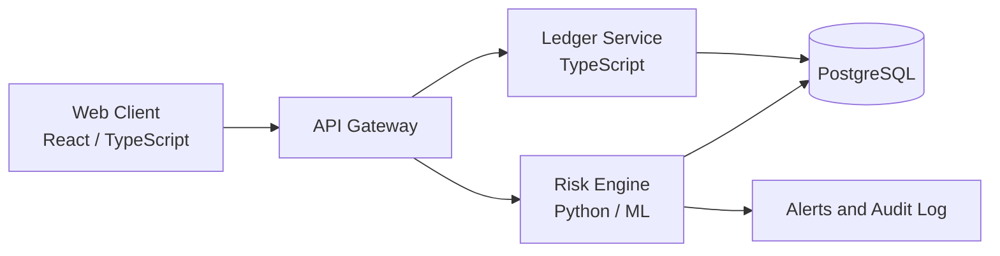

 

 

  

---

## 🟢 MISSION

**Build scalable technology that solves real problems.**

Full-stack software engineer and founder of **WebMakers**. I design and ship systems across
**AI × Cloud × Fintech × Web3 × GovTech**, and turn complex ideas into reliable production software.

📍 Nairobi, Kenya · 🎌 Anime enthusiast who codes

---

## ⚙️ ENGINEERING FOCUS

| Area | Focus | Core tools |
|---|---|---|
| 🤖 **AI Systems** | LLM agents, risk models, prediction engines | Python, Gemini, OpenAI, Claude |
| ☁️ **Cloud** | Deployment, containers, infrastructure | AWS, GCP, Docker, Nginx, Linux, Vercel |
| 💳 **Fintech** | Payments, ledgers, risk scoring | M-Pesa, Daraja, STK Push, APIs |
| ⛓️ **Web3** | Smart contracts, dApps, wallets | Solidity, Ethereum, MetaMask |

**Stack:** TypeScript · Python · React · Next.js · Node.js · Express · Flask · PostgreSQL · SQLite · Docker

---

## 🎬 FLAGSHIP PROJECTS

### 🏦 CREDITICA: AI-Powered Banking Fintech

**Banking fintech platform with AI-driven risk detection.**

- **What it does:** Account and credit workflows with real-time risk scoring on every transaction.
- **Risk engine:** Python service that scores transactions and flags anomalies for review.
- **Client:** TypeScript web app for customers and operations staff.
- **Architecture:** Modular services behind one API gateway, with an audit trail on every decision.

**Stack:** TypeScript · Python · AI risk models · PostgreSQL · Docker

---

### 🏛️ AGENT 21: Government Transparency Portal

**A more advanced, eCitizen-style portal that makes government activity visible and rateable.**

- **Activity feed:** Government projects, decisions, and spending in one timeline.
- **Contracts:** Public tenders with price benchmarks that flag overpriced contracts.
- **Ratings:** Agency and project performance scores from published data.
- **Timeline:** Every contract and milestone traced from award to delivery.

**Stack:** AI · Data pipelines · Public-data integrations

---

### ⚽ ODDSARENA: AI Football Prediction

**AI-driven football prediction engine powered by LLM engines.**

- **Models:** Python prediction pipelines combined with LLM reasoning over match data.
- **Product:** TypeScript front end for predictions, analytics, and user engagement.
- **Output:** Match probabilities and explanations users can read, not just a score.

**Stack:** Python · TypeScript · LLM engines

---

### 💼 KAZI MAJU: Job Board for Kenya → Abroad

**A job application board connecting Kenyan job seekers with work abroad.**

- **Matching:** AI-assisted matching between candidate profiles and overseas listings.
- **Applications:** Track every application from submission to decision.
- **Access:** Built mobile-first for job seekers across Kenya.

**Stack:** Python · TypeScript · AI matching

---

## 🚀 ACTIVE PROJECTS

| Project | What it is | Stack |
|---|---|---|
| 🟢 **MQULIMA** | AI-powered agricultural ecosystem: crop diagnostics, market intelligence, digital marketplace, payments | React · Node.js · PostgreSQL |
| 🟡 **TAIFASTATS** | Cryptographic football ticketing with QR validation, offline checks, and M-Pesa payments | M-Pesa · QR · Crypto verification |
| 🔴 **WEBMAKERS** | Digital product studio: 30+ projects, business sites, SaaS, payments, cloud deployment | Production engineering |

---

## 📊 GITHUB COMMAND CENTER

  

  

---

## 🚀 LET'S BUILD

### Have a difficult problem?

# **Good.**

### I like difficult problems.

 

  

> **TURNING IDEAS INTO PRODUCTION SYSTEMS.**
>
> **ONE COMMIT AT A TIME.**

