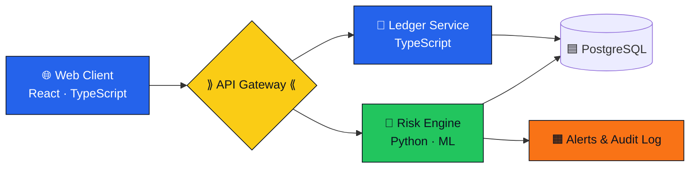

 

<table>
<tr>
<td width="62%" valign="top">

 

### ◆ MISSION

**Build scalable technology that solves real problems.**

Full-stack software engineer and founder of **WebMakers**. I ship systems across
**AI ✦ Cloud ✦ Fintech ✦ Web3 ✦ GovTech**, and turn complex ideas into reliable production software.

**📍 Nairobi, Kenya** · **🎌 Anime enthusiast who codes**

</td>
<td width="38%" valign="top">

 

 
 
 
 

</td>
</tr>
</table>

 

 

| ◆ Area | ✦ Focus | ▸ Core tools |
|:---|:---|:---|
| **AI Systems** | LLM agents · risk models · prediction engines | Python · Gemini · OpenAI · Claude |
| **Cloud** | Deployment · containers · infrastructure | AWS · GCP · Docker · Nginx · Linux |
| **Fintech** | Payments · ledgers · risk scoring | M-Pesa · Daraja · STK Push · APIs |
| **Web3** | Smart contracts · dApps · wallets | Solidity · Ethereum · MetaMask |

**⟫ STACK ⟪** TypeScript ✦ Python ✦ React ✦ Next.js ✦ Node.js ✦ Express ✦ Flask ✦ PostgreSQL ✦ Docker

  

 

> **Banking fintech with AI-driven risk detection.**

**▸ What it does:** Account and credit workflows, with real-time risk scoring on every transaction.
**▸ Risk engine:** Python service that scores transactions and flags anomalies for review.
**▸ Client:** TypeScript web app for customers and operations staff.
**▸ Architecture:** Modular services behind one API gateway, with an audit trail on every decision.

**◆ Stack:** `TypeScript` · `Python` · `AI risk models` · `PostgreSQL` · `Docker`

  

> **An eCitizen-style portal that makes government activity visible and rateable.**

**▸ Activity feed:** Government projects, decisions, and spending in one timeline.
**▸ Contracts:** Public tenders benchmarked on price, with overpriced contracts flagged.
**▸ Ratings:** Agency and project performance scores from published data.
**▸ Timeline:** Every contract and milestone traced from award to delivery.

**◆ Stack:** `AI` · `Data pipelines` · `Public-data integrations`

  

> **AI football prediction engine powered by LLM engines.**

**▸ Models:** Python prediction pipelines combined with LLM reasoning over match data.
**▸ Product:** TypeScript front end for predictions, analytics, and user engagement.
**▸ Output:** Match probabilities with explanations users can read, not just a score.

**◆ Stack:** `Python` · `TypeScript` · `LLM engines`

  

> **Connects Kenyan job seekers with work abroad.**

**▸ Matching:** AI-assisted matching between candidate profiles and overseas listings.
**▸ Applications:** Track every application from submission to decision.
**▸ Access:** Built mobile-first for job seekers across Kenya.

**◆ Stack:** `Python` · `TypeScript` · `AI matching`

  

 

| Project | What it is | Stack |
|:---|:---|:---|
| **MQULIMA** | AI agricultural ecosystem: crop diagnostics, market intelligence, marketplace, payments | React · Node.js · PostgreSQL |
| **TAIFASTATS** | Cryptographic football ticketing with QR validation, offline checks, M-Pesa payments | M-Pesa · QR · Crypto verification |
| **WEBMAKERS** | Digital product studio: 30+ projects, business sites, SaaS, payments, cloud | Production engineering |

  

 

  

  

